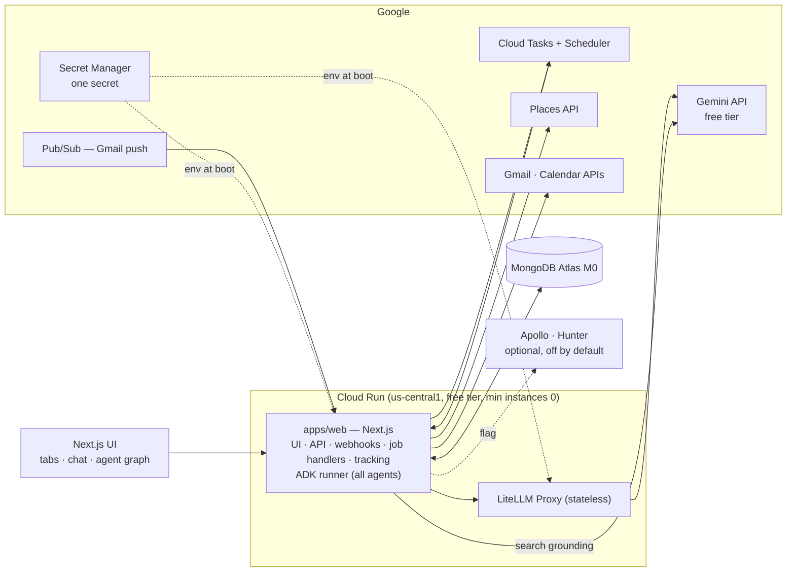

# Sutra — Build Plan

> **Sutra** (सूत्र, "thread") — one thread from first touch to closed deal.
> Paste your website. Sutra learns your business, finds your ideal customers, writes and A/B-tests the outreach, and books meetings. A person approves before anything is sent.

Each `NN-*.md` file in this folder is **one PR**. Merge them in order; each PR leaves `main` green and deployable.

---

## 1. The experience

The user types **one thing**, their website URL. The rest runs on its own, with **two human checkpoints**.

```
 ① Paste URL ──▶ Profiler agents research the business
                      │
                      ▼
 ② CHECKPOINT 1 — "Is this you?"  Business profile + ideal customer profile (ICP) + buyer personas
                  (edit inline or via chat: "focus on Indonesia, skip enterprises") → Confirm
                      │
                      ▼
    Prospector agents (in parallel, several sources) → contacts → enrichment → scoring
                      │
                      ▼
    Copywriter agents → multi-step email sequence with A/B variants per step
                      │
                      ▼
 ③ CHECKPOINT 2 — "Approve campaign"  prospects + sequence + variants + compliance report → Approve
                      │
                      ▼
    Sends (timezone-aware, warm-up limits) → opens/clicks/replies → reply analyst → meetings
                      │
                      ▼
    Optimizer agent → new challenger variants → approval queue (nothing sent unapproved)
```

The **live agent graph** in the top bar shows each agent and sub-agent as it runs. The **chat sidebar** answers questions ("why is this a fit?") and makes changes ("rewrite step 2 more casually", "remove leads from Thailand", "pause the campaign").

### Layout

```
┌──────────────────────────────────────────────────────────────────────────────┐
│  ◉ Orchestrator ─▶ ◉ Profiler ─▶ ◉ Prospector ─┬▶ Search  ─▶ ◉ Enricher ─▶ … │  live agent graph
│                                                ├▶ Lookalike                   │
│                                                └▶ Places                      │
├──────────────────────────────────────────────────────────────┬───────────────┤
│  [ Business ]  [ Prospects ]  [ Campaigns ]  [ Leads ]       │   AI chat     │
│                                                              │               │
│   tab content (tables, cards, editors)                       │  context-     │
│                                                              │  aware of tab │
│                                                              │  + selection  │
└──────────────────────────────────────────────────────────────┴───────────────┘
```

| Tab | Shows |
|---|---|
| **Business** | Company profile, offerings, proof points, ICP, buyer personas, tone of voice. Editable. Checkpoint 1 lives here. |
| **Prospects** | Everyone found: source, company, contact, score + reasons, compliance status |
| **Campaigns** | Sequences with steps and A/B variants, per-variant stats (reply / click / open≈), approval queue for new variants. Checkpoint 2 lives here. |
| **Leads** | Status cards (**Interested** · **Not interested** · **Meeting booked** · **Awaiting reply**) above a table of everyone contacted, with the thread for each |

---

## 2. Architecture



### Key decisions

| Decision | Choice | Why |
|---|---|---|
| Language | **TypeScript everywhere** | One Zod schema serves as the type, API validator, form validator, ADK tool parameters and Mongo validator. |
| Agents | **`@google/adk` (ADK-JS v2.3)** | Official, Apache-2.0. Zod `FunctionTool`s, `requireConfirmation`, `RoutedLlm`, pluggable `BaseLlm` / `BaseSessionService`. |
| Web | **Next.js 16 App Router**, a single deployable | UI, API, webhooks, jobs and email tracking in one service. |
| DB | **MongoDB Atlas M0** (native driver + Zod) | One generic `repository()`; ADK sessions stored in Mongo via a custom `MongoSessionService`. |
| LLMs | **LiteLLM Proxy** (stateless) + one `LiteLlm extends BaseLlm` adapter | Any provider through YAML. Google Search grounding calls Gemini directly. |
| Pipeline | **Declarative pipeline graph** (`pipeline.ts`) | The same definition drives execution **and** the live agent graph UI. |
| Chat | **ADK agent whose tools are the app's own Server Actions** | Every action is automatically a chat tool. Mutations require confirmation in chat. |
| A/B testing | **Thompson-sampling bandit**, reply rate as the primary metric | Works with small volumes; opens are unreliable (privacy proxies), so they're shown as approximate. |
| Email | **Gmail API** from the user's own mailbox | Real replies and better deliverability; warm-up limits built in. |
| Auth | **Better Auth** + organization plugin | Workspaces, roles and Google OAuth with Gmail scopes. |
| Secrets | **One Secret Manager secret (`SUTRA_ENV`) → `@sutra/config`** | One place; a lint rule bans `process.env` elsewhere. |
| Jobs | **Cloud Tasks** (prod) / inline (dev), behind `enqueue()` | Scheduled sends without an always-on worker. |
| UI | Tailwind v4 + shadcn/ui + **React Flow** (agent graph) + next-intl | Clean, modern, little custom CSS. |

### Design principles
1. **LLMs for language, code for control flow.** The pipeline, sequences, compliance, bandit and routing are deterministic TypeScript. Agents research, write and understand.
2. **Zod is the single source of truth.**
3. **One definition, many uses**: `pipeline.ts` runs the agents and draws the graph; each Server Action is also a chat tool; each `LeadSource` is a prospector sub-agent.
4. **Data over code**: country compliance packs, model aliases and source configs are data.
5. **Nothing is sent without approval.** Enforced by type: the send function requires an approved-variant token.
6. **Every side effect is idempotent and audited.**

---

## 3. Repository layout

```
sutra/
├─ apps/
│  └─ web/                 Next.js (UI, API, webhooks, jobs, tracking, agents)
├─ packages/
│  ├─ config/              env + secrets (the ONLY reader of process.env)
│  ├─ domain/              Zod schemas, enums, pure helpers (isomorphic)
│  ├─ db/                  Mongo client, repository(), indexes, MongoSessionService
│  ├─ agents/              ADK agents, tools, prompts, pipeline, LiteLlm adapter
│  ├─ sources/             LeadSource implementations (search, lookalike, places, registry, csv, apollo, hunter)
│  ├─ mail/                Gmail send, threading, tracking, reply sync
│  └─ compliance/          policy engine + country rule packs
├─ infra/
│  ├─ litellm/config.yaml
│  ├─ cloudbuild.yaml
│  └─ terraform/
└─ todo/                   ← this plan
```

---

## 4. PR index

| # | PR | Size | Demo-critical |
|---|---|---|---|
| 01 | [Monorepo foundation](01-monorepo-foundation.md) | S | ✅ |
| 02 | [Config and secrets (one place)](02-config-and-secrets.md) | S | ✅ |
| 03 | [Domain schemas and DB layer](03-domain-and-db.md) | M | ✅ |
| 04 | [Auth and workspaces](04-auth-and-workspaces.md) | S | ✅ |
| 05 | [App shell: tabs, chat panel, graph bar, i18n](05-app-shell.md) | M | ✅ |
| 06 | [LLM gateway, ADK runtime, pipeline engine](06-llm-gateway-and-adk-runtime.md) | M | ✅ |
| 07 | [Business profiler and ICP (checkpoint 1)](07-business-profiler-and-icp.md) | M | ✅ |
| 08 | [Multi-source prospecting](08-multi-source-prospecting.md) | L | ✅ |
| 09 | [Enrichment and scoring](09-enrichment-and-scoring.md) | M | ✅ |
| 10 | [Compliance engine](10-compliance-engine.md) | M | ✅ |
| 11 | [Gmail sending and tracking](11-gmail-sending-and-tracking.md) | M | ✅ |
| 12 | [Campaign generation and A/B variants](12-campaign-generation-and-variants.md) | M | ✅ |
| 13 | [Approval and campaign engine (checkpoint 2)](13-approval-and-campaign-engine.md) | L | ✅ |
| 14 | [Replies, meetings and Leads tab](14-replies-meetings-leads-tab.md) | M | ✅ |
| 15 | [A/B optimizer](15-ab-optimizer.md) | M | ⭐ |
| 16 | [Chat copilot](16-chat-copilot.md) | M | ⭐ |
| 17 | [Live agent graph](17-agent-graph.md) | S | ⭐ |
| 18 | [Observability, evals, hardening](18-observability-evals-hardening.md) | M | |
| 19 | [Deploy and demo](19-deploy-and-demo.md) | S | ✅ |

✅ = needed for the end-to-end demo · ⭐ = wow factor for judges.

**Hackathon cut line:** 01–14 + 17 + 19 gives the full autonomous flow with a visible agent graph. Then add 16 (chat), then 15 (optimizer; the bandit stats can ship before the challenger generator).

---

## 5. Zero-cost setup

Every service runs on a free tier. Free-tier limits change often, so verify each one in its console before relying on it.

| Service | Free plan used | Limit | How the plan stays inside it |
|---|---|---|---|
| **Gemini API** (AI Studio key) | Free tier, Flash / Flash-Lite | Per-minute and per-day caps; Pro is paid | `sutra-fast` = Flash-Lite, `sutra-smart` = Flash; backoff on 429; caching |
| Google Search grounding | Free grounded-request quota | Paid past the quota | Per-run query budget; results cached 30 days |
| **MongoDB Atlas M0** | Free cluster | 512 MB, 500 connections, no backups, capped change streams | Polling instead of change streams; retention job |
| **Cloud Run** | Always-free monthly usage | Only in `us-central1`, `us-east1`, `us-west1` | 2 services in `us-central1`, min instances 0 |
| Cloud Tasks, Pub/Sub, Logging, Trace | Monthly free quotas | Far above demo volume | — |
| Cloud Scheduler | 3 free jobs | 3 jobs | One `maintenance` cron |
| Secret Manager | Small free quota | Paid per extra version | One secret `SUTRA_ENV` |
| Artifact Registry | 0.5 GB | Storage | Cleanup policy keeps the latest image only |
| **Places API (New)** | Free monthly cap per SKU | Text Search Enterprise ≈ 1,000 requests/month | Quota guard stops at 900 |
| Gmail, Calendar APIs | Free | Daily send limits per mailbox | Warm-up ramp + daily caps |
| Apollo, Hunter | **Optional paid / freemium** | Their plans' credits | **Off by default**; enabled per workspace with its own API key |

**Billing safety:**
- Set a **$1 budget alert** and daily API quotas.
- Create the **Gemini API key in a separate project with no billing account**, so it can never move to a paid tier.
- Free-tier Gemini prompts may be used by Google to improve its products, so use demo data only.

---

## 6. Conventions (every PR)

- Branch `feat/NN-slug`, conventional commits, PR title `NN: <title>`.
- No `any`. Schemas live in `@sutra/domain`, and types come from `z.infer`.
- `process.env` only inside `@sutra/config`.
- Every external call goes through an interface with a `fake` implementation for tests and demo mode.
- Every agent registers its node in `pipeline.ts`, so it appears in the agent graph.
- Every PR adds Vitest tests and updates `.env.example` if it adds config.
- Definition of done: `pnpm lint && pnpm typecheck && pnpm test && pnpm build` pass in CI.
